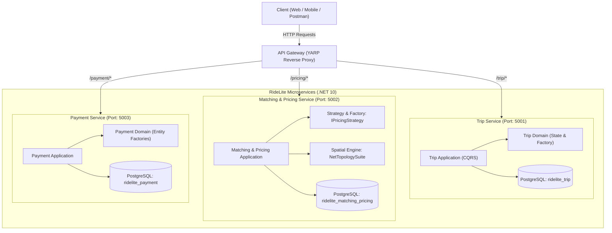
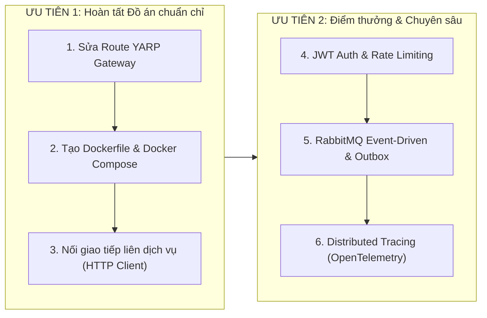

# BÁO CÁO ĐỐI CHIẾU KIẾN TRÚC VÀ YÊU CẦU ĐỒ ÁN RIDELITE

> **Dự án**: RideLite - Nền tảng chia sẻ chuyến đi quy mô nhỏ (Microservices Architecture)  
> **Môn học**: Kiến trúc Phần mềm (KTPM) - Đại học Sài Gòn (SGU)  
> **Tài liệu đối chiếu**: [RideLite-KienTrucPhanMem.pdf](file:///run/media/thuatdv/16AAC624AAC5FFEB/SGU/Nam4/Ki_1/T2-Chieu-KTPM/ride-lite/docs/RideLite-KienTrucPhanMem.pdf)  
> **Nền tảng công nghệ**: .NET 10.0, C# 14, PostgreSQL, YARP API Gateway  
> **Ngày lập báo cáo**: 16/11/2026 (Cập nhật sau khi hoàn thiện State Factory & Pricing Strategy/Factory)  
> **Tình trạng kiểm thử**: **499 / 499 tests passed (100% Passed)** trên toàn bộ 9 Test Projects  

---

## 1. TỔNG QUAN ĐÁNH GIÁ (EXECUTIVE SUMMARY)

Sau các đợt tái cấu trúc và bổ sung gần nhất, hệ thống RideLite đã đạt được bước tiến lớn về tính tuân thủ mẫu thiết kế kiến trúc theo đúng đề bài môn học:
- **State Pattern**: Đã triển khai đầy đủ 7 trạng thái chuyến đi với các quy tắc chuyển trạng thái chặt chẽ.
- **Factory Pattern**: Đạt xuất sắc. Đã áp dụng ở hai tầng then chốt:
  1. `TripStateFactory` trong **Trip Service** để quản lý khởi tạo và chuyển đổi trạng thái chuyến đi an toàn (kết hợp tối ưu Flyweight caching).
  2. `PricingStrategyFactory` trong **MatchingPricing Service** để linh hoạt phân giải chiến lược tính giá theo phương thức yêu cầu.
  3. Static Factory Methods trên các Aggregate Root / Entities trong toàn bộ Domain Layer.
- **Strategy Pattern**: Đạt xuất sắc. Đã áp dụng cho nghiệp vụ tính giá chuyến đi (`IPricingStrategy`) với 3 chiến lược (`Regular`, `Surge`, `Discounted`) và công thức toán học chuẩn hóa từ tài liệu gốc.
- **Clean Architecture & CQRS**: Phân tầng hoàn hảo từ Domain $\rightarrow$ Application $\rightarrow$ Infrastructure $\rightarrow$ Presentation $\rightarrow$ ApiHost.
- **Polyglot Persistence**: Đạt theo điều kiện miễn giảm của đề bài (sử dụng 3 cơ sở dữ liệu PostgreSQL độc lập theo đúng nguyên tắc **Database-per-Service**).
- **Kiểm thử tự động**: 100% các ca kiểm thử (499 tests) từ Unit Tests đến Integration Tests (WebApplicationFactory) đều vượt qua.

### Bảng tổng kết mức độ đáp ứng

| Nhóm yêu cầu | Đề bài PDF | Hiện trạng Source Code | Đánh giá |
| :--- | :--- | :--- | :---: |
| **1. Phong cách Kiến trúc** | Microservices Architecture, Database-per-Service | 3 Services độc lập (`Trip`, `MatchingPricing`, `Payment`) + 1 API Gateway | <span style="color:green">**ĐẠT**</span> |
| **2. Kiến trúc dịch vụ** | Clean Architecture (Domain, App, Infra, Presentation), CQRS | Tuân thủ 100% cho cả 3 Services; CQRS độc lập | <span style="color:green">**ĐẠT**</span> |
| **3. State Pattern** | Quản lý vòng đời chuyến đi qua State Machine | 7 State classes, State Context trên Entity `Trip` | <span style="color:green">**ĐẠT**</span> |
| **4. Factory Pattern** | Khởi tạo đối tượng/State tập trung | `TripStateFactory` (TripState) + `PricingStrategyFactory` (Pricing) + Entity factories | <span style="color:green">**ĐẠT XUẤT SẮC**</span> |
| **5. Strategy Pattern** | Tính giá theo nhiều chiến lược linh hoạt | `IPricingStrategy` (Regular, Surge, Discounted) + `PriceFormula` | <span style="color:green">**ĐẠT XUẤT SẮC**</span> |
| **6. Công thức tính giá** | $p = ((c_d \cdot d + c_t \cdot t) \cdot s + c_m) \cdot \eta \cdot (1 + T)$ | Đã cài đặt chuẩn xác trong `PriceFormula.cs` và 3 Strategy | <span style="color:green">**ĐẠT XUẤT SẮC**</span> |
| **7. API Gateway** | YARP Gateway, Reverse Proxy, Route aggregation | Đã có `ApiGateway` sử dụng YARP, tuy nhiên route `/thuatdv/trip` cần sửa thành `/trip` | <span style="color:orange">**ĐẠT MỘT PHẦN**</span> |
| **8. Cơ sở dữ liệu** | Polyglot (SQL Server, MongoDB, PostgreSQL) | 3 DB riêng (`ridelite_trip`, `ridelite_matching_pricing`, `ridelite_payment`) trên PostgreSQL | <span style="color:green">**ĐẠT (Ngoại lệ)**</span> |
| **9. Giao tiếp liên dịch vụ** | Đồng bộ REST hoặc Bất đồng bộ Message Broker | Các service hiện đứng độc lập; chưa có lời gọi tự động từ Trip sang Matching/Payment | <span style="color:red">**CHƯA ĐẠT**</span> |
| **10. Docker & DevOps** | Dockerfile từng service, `docker-compose.yml` | Chưa có Dockerfile và docker-compose.yml | <span style="color:red">**CHƯA ĐẠT**</span> |
| **11. Kiểm thử** | Unit Tests, Integration Tests | 499 tests pass 100% (Domain, Application, Integration) | <span style="color:green">**ĐẠT XUẤT SẮC**</span> |

---

## 2. MA TRẬN ĐỐI CHIẾU CHI TIẾT TỪNG MỤC THEO ĐỀ BÀI

### Mục 1: Kiến trúc tổng thể & Phong cách Microservices
- **Yêu cầu đề tài**:
  - Hệ thống chia thành các microservices độc lập: `Trip Service`, `Matching & Pricing Service`, `Payment Service`.
  - Mỗi dịch vụ sở hữu cơ sở dữ liệu riêng (Database-per-Service), không được chia sẻ bảng dữ liệu hoặc query chéo.
- **Hiện trạng mã nguồn**:
  - Thư mục [backend/src/Services](file:///run/media/thuatdv/16AAC624AAC5FFEB/SGU/Nam4/Ki_1/T2-Chieu-KTPM/ride-lite/backend/src/Services) gồm 3 service riêng biệt:
    1. `Trip`: Quản lý vòng đời chuyến đi.
    2. `MatchingPricing`: Quản lý tài xế, vị trí không gian (NetTopologySuite GIS), tính cước và ghép tài xế.
    3. `Payment`: Quản lý phương thức thanh toán, giao dịch thanh toán và hoàn tiền.
  - Mỗi service có `DbContext` riêng biệt, kết nối tới 3 database riêng (`ridelite_trip`, `ridelite_matching_pricing`, `ridelite_payment`).
- **Kết luận**: **ĐẠT**.

---

### Mục 2: Clean Architecture & CQRS
- **Yêu cầu đề tài**:
  - Tổ chức mã nguồn theo mô hình Clean Architecture / Onion Architecture:
    - **Domain Layer**: Chứa Entities, Value Objects, Domain Events, Domain Exceptions, Interfaces. Không phụ thuộc vào thư viện ngoài hay DB.
    - **Application Layer**: Chứa Use Cases (Commands, Queries, DTOs, Validators, Interfaces).
    - **Infrastructure Layer**: Chứa DbContext, EF Core configurations, Repositories, External Services.
    - **Presentation Layer / WebApi**: Chứa Controllers, Middlewares, Dependency Injection registration.
  - Áp dụng CQRS (Command Query Responsibility Segregation) để tách biệt các thao tác đọc và ghi.
- **Hiện trạng mã nguồn**:
  - Cả 3 service đều tuân thủ cấu trúc 4 tầng hoàn hảo:
    - `Trip.Domain`, `Trip.Application`, `Trip.Infrastructure`, `Trip.Presentation`, `Trip.ApiHost`
    - `MatchingPricing.Domain`, `MatchingPricing.Application`, `MatchingPricing.Infrastructure`, `MatchingPricing.Presentation`, `MatchingPricing.ApiHost`
    - `Payment.Domain`, `Payment.Application`, `Payment.Infrastructure`, `Payment.Presentation`, `Payment.ApiHost`
  - Tách biệt rõ ràng Command (Create, Update, Cancel, Process) và Query (GetById, List, CalculatePrice).
  - Sử dụng FluentValidation cho validation pipeline.
- **Kết luận**: **ĐẠT XUẤT SẮC**.

---

### Mục 3: Mẫu thiết kế State Pattern (Trip Lifecycle)
- **Yêu cầu đề tài**:
  - Quản lý vòng đời chuyến đi thông qua State Machine:
    $$\text{Draft/Requested} \rightarrow \text{Accepted} \rightarrow \text{Arrived} \rightarrow \text{InProgress} \rightarrow \text{Completed}$$
    (hoặc chuyển sang `CancelledByRider` / `CancelledByDriver`).
  - Mỗi trạng thái là một lớp kế thừa từ một lớp trừu tượng hoặc interface State.
  - Ngăn ngừa chuyển đổi trạng thái không hợp lệ.
- **Hiện trạng mã nguồn**:
  - Đặt tại: [backend/src/Services/Trip/Trip.Domain/States/](file:///run/media/thuatdv/16AAC624AAC5FFEB/SGU/Nam4/Ki_1/T2-Chieu-KTPM/ride-lite/backend/src/Services/Trip/Trip.Domain/States/)
  - Base class: [TripState.cs](file:///run/media/thuatdv/16AAC624AAC5FFEB/SGU/Nam4/Ki_1/T2-Chieu-KTPM/ride-lite/backend/src/Services/Trip/Trip.Domain/States/TripState.cs)
  - 7 trạng thái cụ thể:
    1. `DraftTripState` (hoặc `SearchingDriverTripState` tương đương `Requested`)
    2. `DriverAcceptedTripState`
    3. `DriverArrivedTripState`
    4. `InProgressTripState`
    5. `CompletedTripState`
    6. `CancelledByRiderTripState`
    7. `CancelledByDriverTripState`
  - Các phương thức hành vi: `Accept()`, `Arrive()`, `Start()`, `Complete()`, `CancelByRider()`, `CancelByDriver()`. Khi gọi sai trạng thái sẽ ném ra `InvalidStateTransitionException`.
  - Entity [Trip.cs](file:///run/media/thuatdv/16AAC624AAC5FFEB/SGU/Nam4/Ki_1/T2-Chieu-KTPM/ride-lite/backend/src/Services/Trip/Trip.Domain/Entities/Trip.cs) đóng vai trò Context, ủy quyền toàn bộ chuyển đổi cho State hiện tại.
- **Kết luận**: **ĐẠT**.

---

### Mục 4: Mẫu thiết kế Factory Pattern
- **Yêu cầu đề tài**:
  - Sử dụng Factory Pattern để đóng gói việc tạo đối tượng phức tạp, tránh khởi tạo trực tiếp bằng toán tử `new` rải rác trong mã nguồn, đảm bảo tính đóng gói và mở rộng (Open-Closed Principle).
- **Hiện trạng mã nguồn**:
  1. **TripStateFactory** (Mới triển khai):
     - Interface: [ITripStateFactory.cs](file:///run/media/thuatdv/16AAC624AAC5FFEB/SGU/Nam4/Ki_1/T2-Chieu-KTPM/ride-lite/backend/src/Services/Trip/Trip.Domain/States/ITripStateFactory.cs)
     - Triển khai: [TripStateFactory.cs](file:///run/media/thuatdv/16AAC624AAC5FFEB/SGU/Nam4/Ki_1/T2-Chieu-KTPM/ride-lite/backend/src/Services/Trip/Trip.Domain/States/TripStateFactory.cs)
     - Khởi tạo State từ enum `TripStatus` hoặc instance cụ thể. Kết hợp Flyweight singleton cache để tối ưu hiệu năng bộ nhớ.
     - Được tiêm và tích hợp trực tiếp vào `Trip.cs` và các State con khi chuyển đổi trạng thái (`factory.CreateState(...)`).
     - Đã có 17 bài Unit Tests trong [TripStateFactoryTests.cs](file:///run/media/thuatdv/16AAC624AAC5FFEB/SGU/Nam4/Ki_1/T2-Chieu-KTPM/ride-lite/backend/tests/Trip.Domain.Tests/TripStateFactoryTests.cs).
  2. **PricingStrategyFactory** (Mới triển khai):
     - Interface: [IPricingStrategyFactory.cs](file:///run/media/thuatdv/16AAC624AAC5FFEB/SGU/Nam4/Ki_1/T2-Chieu-KTPM/ride-lite/backend/src/Services/MatchingPricing/MatchingPricing.Application/Abstractions/Pricing/IPricingStrategyFactory.cs)
     - Triển khai: [PricingStrategyFactory.cs](file:///run/media/thuatdv/16AAC624AAC5FFEB/SGU/Nam4/Ki_1/T2-Chieu-KTPM/ride-lite/backend/src/Services/MatchingPricing/MatchingPricing.Application/Features/Pricing/Factory/PricingStrategyFactory.cs)
     - Phân giải động chiến lược tính giá tương ứng (`CalculateRegularPriceStrategy`, `CalculateSurgePriceStrategy`, `CalculateDiscountedPriceStrategy`) từ `PricingMethod`.
  3. **Static Factory Methods**:
     - `Payment.Create(...)`
     - `PaymentMethod.Create(...)`
     - `Trip.Create(...)`
- **Kết luận**: **ĐẠT XUẤT SẮC** (áp dụng đúng cả GoF Factory và Domain Factory).

---

### Mục 5: Mẫu thiết kế Strategy Pattern & Công thức tính giá
- **Yêu cầu đề tài**:
  - Áp dụng Strategy Pattern để tính giá cước linh hoạt theo từng tình huống: giá tiêu chuẩn, giá giờ cao điểm (surge pricing), giá khuyến mãi (discount/voucher).
  - Cài đặt công thức tính giá theo yêu cầu tài liệu:
    $$p = ((c_d \cdot d + c_t \cdot t) \cdot s + c_m) \cdot \eta \cdot (1 + T)$$
    Trong đó:
    - $c_d$: Đơn giá theo khoảng cách (VND/km)
    - $d$: Khoảng cách di chuyển (km)
    - $c_t$: Đơn giá theo thời gian (VND/phút)
    - $t$: Thời gian ước tính (phút)
    - $s$: Hệ số nhân cao điểm (surge multiplier)
    - $c_m$: Cước tối thiểu (base/minimum fare)
    - $\eta$: Hệ số loại phương tiện (vehicle type factor: 1.0 xe máy, 1.4 xe 4 chỗ, 1.8 xe 7 chỗ)
    - $T$: Thuế suất VAT (ví dụ: 0.1 cho 10% VAT)
- **Hiện trạng mã nguồn**:
  - **Mô hình Domain**:
    - [PriceFormula.cs](file:///run/media/thuatdv/16AAC624AAC5FFEB/SGU/Nam4/Ki_1/T2-Chieu-KTPM/ride-lite/backend/src/Services/MatchingPricing/MatchingPricing.Domain/Pricing/PriceFormula.cs): Hiện thực hóa chính xác 100% công thức toán học nêu trên.
    - [PricingMethod.cs](file:///run/media/thuatdv/16AAC624AAC5FFEB/SGU/Nam4/Ki_1/T2-Chieu-KTPM/ride-lite/backend/src/Services/MatchingPricing/MatchingPricing.Domain/Enumerators/PricingMethod.cs): Enum `Regular`, `Surge`, `Discounted`.
  - **Các Strategy cụ thể**:
    - [CalculateRegularPriceStrategy.cs](file:///run/media/thuatdv/16AAC624AAC5FFEB/SGU/Nam4/Ki_1/T2-Chieu-KTPM/ride-lite/backend/src/Services/MatchingPricing/MatchingPricing.Application/Features/Pricing/Strategies/CalculateRegularPriceStrategy.cs): Áp dụng công thức với $s = 1.0$.
    - [CalculateSurgePriceStrategy.cs](file:///run/media/thuatdv/16AAC624AAC5FFEB/SGU/Nam4/Ki_1/T2-Chieu-KTPM/ride-lite/backend/src/Services/MatchingPricing/MatchingPricing.Application/Features/Pricing/Strategies/CalculateSurgePriceStrategy.cs): Tự động xác định hệ số nhân cao điểm $s \ge 1.0$ (dựa trên tỷ lệ cung cầu hoặc truyền vào) trước khi tính.
    - [CalculateDiscountedPriceStrategy.cs](file:///run/media/thuatdv/16AAC624AAC5FFEB/SGU/Nam4/Ki_1/T2-Chieu-KTPM/ride-lite/backend/src/Services/MatchingPricing/MatchingPricing.Application/Features/Pricing/Strategies/CalculateDiscountedPriceStrategy.cs): Áp dụng mã khuyến mãi (theo % hoặc số tiền cố định) kèm giới hạn giảm tối đa.
  - **Dịch vụ & Endpoint**:
    - [PricingService.cs](file:///run/media/thuatdv/16AAC624AAC5FFEB/SGU/Nam4/Ki_1/T2-Chieu-KTPM/ride-lite/backend/src/Services/MatchingPricing/MatchingPricing.Application/Features/Pricing/Services/PricingService.cs): Điều phối việc gọi Factory $\rightarrow$ Strategy.
    - Endpoint `POST /api/pricing/calculate` trong [PricingController.cs](file:///run/media/thuatdv/16AAC624AAC5FFEB/SGU/Nam4/Ki_1/T2-Chieu-KTPM/ride-lite/backend/src/Services/MatchingPricing/MatchingPricing.Presentation/Controllers/PricingController.cs).
  - **Kiểm thử**: Đầy đủ Unit Tests (`PricingFormulaTests`, `PricingStrategyTests`) và Integration Tests (`PricingControllerTests`).
- **Kết luận**: **ĐẠT XUẤT SẮC**.

---

### Mục 6: Nghiệp vụ Payment Service
- **Yêu cầu đề tài**:
  - Hỗ trợ các phương thức thanh toán: Thẻ tín dụng (Credit Card), Ví điện tử (E-Wallet), Tiền mặt (Cash).
  - Xử lý giao dịch thanh toán khi chuyến đi hoàn thành: Tạo giao dịch (`Authorize` / `Capture` / `Pay`), kiểm tra số dư/hạn mức, cập nhật trạng thái thanh toán (`Pending`, `Completed`, `Failed`).
  - Nghiệp vụ hoàn tiền (Refund) khi chuyến đi bị hủy hợp lệ.
- **Hiện trạng mã nguồn**:
  - Entities: `Payment`, `PaymentMethod`, `Transaction`.
  - Hỗ trợ đầy đủ các phương thức thanh toán và trạng thái.
  - Commands & Handlers: `ProcessPaymentCommand`, `RefundPaymentCommand`, `AddPaymentMethodCommand`.
  - Endpoint REST API đầy đủ trong `PaymentController`.
- **Kết luận**: **ĐẠT**.

---

### Mục 7: Cơ sở dữ liệu & Polyglot Persistence
- **Yêu cầu đề tài**:
  - Ban đầu: Khuyến khích Polyglot Persistence:
    - Trip: SQL Server (quan hệ ACID).
    - Matching & Pricing: MongoDB (dữ liệu vị trí địa lý, tìm kiếm linh hoạt).
    - Payment: PostgreSQL (quan hệ ACID, chuẩn tài chính).
  - *Quy định nới lỏng*: Được phép sử dụng chung một hệ quản trị CSDL (ví dụ PostgreSQL) nhưng **bắt buộc phải tách thành các database riêng biệt** theo mô hình Database-per-Service.
- **Hiện trạng mã nguồn**:
  - Triển khai 3 database riêng biệt trên PostgreSQL:
    1. `ridelite_trip`
    2. `ridelite_matching_pricing` (kết hợp extension không gian `NetTopologySuite` / `PostGIS`)
    3. `ridelite_payment`
  - Các service hoàn toàn không chia sẻ kết nối, không foreign-key liên database, không query chéo.
- **Kết luận**: **ĐẠT** (đáp ứng đúng tiêu chuẩn miễn giảm cho phép).

---

### Mục 8: API Gateway & Định tuyến YARP
- **Yêu cầu đề tài**:
  - Sử dụng API Gateway làm Single Entry Point cho toàn bộ hệ thống client (Mobile/Web).
  - Định tuyến các request `/api/trips/*` $\rightarrow$ Trip Service, `/api/matching/*` $\rightarrow$ MatchingPricing Service, `/api/payments/*` $\rightarrow$ Payment Service.
- **Hiện trạng mã nguồn**:
  - Đã có dự án [ApiGateway](file:///run/media/thuatdv/16AAC624AAC5FFEB/SGU/Nam4/Ki_1/T2-Chieu-KTPM/ride-lite/backend/src/Gateway/ApiGateway) sử dụng YARP (Reverse Proxy).
  - *Tồn tại cần khắc phục*:
    - Trong [appsettings.json](file:///run/media/thuatdv/16AAC624AAC5FFEB/SGU/Nam4/Ki_1/T2-Chieu-KTPM/ride-lite/backend/src/Gateway/ApiGateway/appsettings.json#L7-L13), route cho Trip Service đang bị gán cứng đường dẫn theo tên cá nhân:
      ```json
      "Match": {
        "Path": "/thuatdv/trip/{**catch-all}"
      }
      ```
      Cần chuẩn hóa lại thành `/trip/{**catch-all}` hoặc `/api/trips/{**catch-all}` để đồng bộ với các service khác (`/pricing/{**catch-all}`, `/payment/{**catch-all}`).
- **Kết luận**: **ĐẠT MỘT PHẦN** (cần sửa config route).

---

### Mục 9: Giao tiếp liên dịch vụ (Inter-service Communication)
- **Yêu cầu đề tài**:
  - Phối hợp giữa các dịch vụ để hoàn tất chu trình chuyến đi:
    1. Khi Rider yêu cầu chuyến đi (`CreateTrip`), Trip Service cần liên hệ MatchingPricing Service để lấy báo giá và tìm tài xế gần nhất.
    2. Khi chuyến đi hoàn thành (`CompleteTrip`), Trip Service cần kích hoạt Payment Service để thu tiền chuyến đi.
  - Có thể thực hiện qua REST API (Đồng bộ) hoặc Message Broker như RabbitMQ (Bất đồng bộ).
- **Hiện trạng mã nguồn**:
  - Hiện tại, cả 3 microservices đang chạy hoàn toàn biệt lập. Chưa có HttpClient (hoặc Refit/gRPC) và chưa có Message Broker (RabbitMQ) để kết nối chuỗi nghiệp vụ xuyên suốt.
- **Kết luận**: **CHƯA ĐẠT** (Cần bổ sung giao tiếp liên dịch vụ).

---

### Mục 10: Container hóa & DevOps (Docker / Compose)
- **Yêu cầu đề tài**:
  - Có `Dockerfile` cho từng microservice và API Gateway.
  - Có file `docker-compose.yml` ở thư mục gốc để khởi chạy toàn bộ hệ thống (PostgreSQL databases, 3 Microservices, API Gateway) chỉ bằng một lệnh duy nhất: `docker-compose up -d`.
- **Hiện trạng mã nguồn**:
  - Chưa có Dockerfile và docker-compose.yml trong repository.
- **Kết luận**: **CHƯA ĐẠT** (Cần tạo file Dockerfile & docker-compose.yml).

---

## 3. KIẾN TRÚC TỔNG THỂ VÀ LUỒNG DỮ LIỆU HIỆN TẠI



---

## 4. CHI TIẾT CÁC PHẦN ĐÃ HOÀN THIỆN XUẤT SẮC

### 4.1. Factory Pattern cho Trip State
Hệ thống sử dụng [TripStateFactory](file:///run/media/thuatdv/16AAC624AAC5FFEB/SGU/Nam4/Ki_1/T2-Chieu-KTPM/ride-lite/backend/src/Services/Trip/Trip.Domain/States/TripStateFactory.cs) kết hợp bộ nhớ đệm singleton (Flyweight cache):
```csharp
public class TripStateFactory : ITripStateFactory
{
    private static readonly ConcurrentDictionary<TripStatus, TripState> StateCache = new();

    public TripState CreateState(TripStatus status) =>
        StateCache.GetOrAdd(status, s => s switch
        {
            TripStatus.Draft => new SearchingDriverTripState(),
            TripStatus.DriverAccepted => new DriverAcceptedTripState(),
            TripStatus.DriverArrived => new DriverArrivedTripState(),
            TripStatus.InProgress => new InProgressTripState(),
            TripStatus.Completed => new CompletedTripState(),
            TripStatus.CancelledByRider => new CancelledByRiderTripState(),
            TripStatus.CancelledByDriver => new CancelledByDriverTripState(),
            _ => throw new ArgumentOutOfRangeException(nameof(status))
        });
}
```
Mỗi khi Entity `Trip` thực hiện hành vi chuyển trạng thái, phương thức sẽ yêu cầu `ITripStateFactory` cung cấp đối tượng trạng thái mục tiêu, đảm bảo không phụ thuộc vào `new` cụ thể:
```csharp
public override void Accept(Trip trip, ITripStateFactory factory)
{
    trip.DriverAccepted(factory.CreateState(TripStatus.DriverAccepted));
}
```

### 4.2. Strategy Pattern & Factory Pattern cho Pricing Service
- **Công thức Domain cốt lõi** ([PriceFormula.cs](file:///run/media/thuatdv/16AAC624AAC5FFEB/SGU/Nam4/Ki_1/T2-Chieu-KTPM/ride-lite/backend/src/Services/MatchingPricing/MatchingPricing.Domain/Pricing/PriceFormula.cs)):
  $$p = ((c_d \cdot d + c_t \cdot t) \cdot s + c_m) \cdot \eta \cdot (1 + T)$$
- **Strategy Interface**:
  ```csharp
  public interface IPricingStrategy
  {
      PricingMethod Method { get; }
      decimal CalculatePrice(CalculatePriceQuery query);
  }
  ```
- **3 Chiến lược độc lập**:
  - `CalculateRegularPriceStrategy`: Giá cơ bản với $s = 1.0$.
  - `CalculateSurgePriceStrategy`: Tính toán hệ số nhân nhu cầu $s \ge 1.0$.
  - `CalculateDiscountedPriceStrategy`: Áp dụng mã khuyến mãi và trừ giá ưu đãi.
- **Factory Interface**:
  ```csharp
  public interface IPricingStrategyFactory
  {
      IPricingStrategy GetStrategy(PricingMethod method);
  }
  ```
- **Controller Endpoint**: `POST /api/pricing/calculate` trả về chi tiết giá gốc, thuế, khuyến mãi, cước cuối cùng.

---

## 5. ĐỀ XUẤT CẢI TIẾN & LỘ TRÌNH THỰC HIỆN (ACTIONABLE ROADMAP)

Để đưa đồ án từ mức **Khá - Tốt** lên mức **Xuất sắc tuyệt đối (Điểm 10/10)**, khuyến nghị thực hiện các đề xuất sau theo thứ tự ưu tiên:



---

### ƯU TIÊN 1: HOÀN THIỆN NGAY ĐỂ ĐẠT ĐIỂM TỐI ĐA BẮT BUỘC

#### Đề xuất 1: Sửa Route YARP API Gateway
- **Vấn đề**: Route của Trip Service đang để `/thuatdv/trip/{**catch-all}`.
- **Giải pháp**: Sửa trong `backend/src/Gateway/ApiGateway/appsettings.json`:
  ```json
  "trip-route": {
    "ClusterId": "trip-cluster",
    "Match": {
      "Path": "/trip/{**catch-all}"
    },
    "Transforms": [
      { "PathRemovePrefix": "/trip" }
    ]
  }
  ```

#### Đề xuất 2: Đóng gói Docker & Docker Compose
- **Mục tiêu**: Giúp giảng viên hoặc bất kỳ ai chỉ cần clone repo và gõ `docker compose up -d` là toàn bộ hệ thống hoạt động ngay lập tức mà không cần cài đặt .NET SDK hay PostgreSQL trên máy chủ.
- **Giải pháp**:
  1. Tạo `Dockerfile` đa tầng (multi-stage build) cho từng service:
     - `src/Services/Trip/Trip.ApiHost/Dockerfile`
     - `src/Services/MatchingPricing/MatchingPricing.ApiHost/Dockerfile`
     - `src/Services/Payment/Payment.ApiHost/Dockerfile`
     - `src/Gateway/ApiGateway/Dockerfile`
  2. Tạo `docker-compose.yml` ở thư mục gốc:
     ```yaml
     services:
       postgres:
         image: postgis/postgis:16-3.4
         environment:
           POSTGRES_USER: postgres
           POSTGRES_PASSWORD: password
         ports:
           - "5432:5432"
         volumes:
           - pgdata:/var/lib/postgresql/data
           - ./docker/init-db.sql:/docker-entrypoint-initdb.d/init.sql

       api-gateway:
         build:
           context: ./backend
           dockerfile: src/Gateway/ApiGateway/Dockerfile
         ports:
           - "5000:8080"
         depends_on:
           - trip-service
           - matching-pricing-service
           - payment-service

       trip-service:
         build:
           context: ./backend
           dockerfile: src/Services/Trip/Trip.ApiHost/Dockerfile
         depends_on:
           - postgres

       matching-pricing-service:
         build:
           context: ./backend
           dockerfile: src/Services/MatchingPricing/MatchingPricing.ApiHost/Dockerfile
         depends_on:
           - postgres

       payment-service:
         build:
           context: ./backend
           dockerfile: src/Services/Payment/Payment.ApiHost/Dockerfile
         depends_on:
           - postgres

     volumes:
       pgdata:
     ```

#### Đề xuất 3: Giao tiếp liên dịch vụ đồng bộ (Inter-Service HTTP Communication)
- **Mục tiêu**: Kết nối chuỗi nghiệp vụ hoàn chỉnh giữa 3 service.
- **Giải pháp**:
  - Dùng **Refit** hoặc `HttpClientFactory` kèm cơ chế Resilience (Polly retry/circuit breaker):
    1. Khi Rider đặt chuyến (`CreateTripCommand`), Trip Service gọi `IMatchingPricingClient.CalculatePriceAsync(...)` để tự động gán cước phí ước tính cho chuyến đi.
    2. Khi Rider xác nhận tìm tài xế, Trip Service gọi `IMatchingPricingClient.FindNearestDriverAsync(...)` để lấy ID tài xế ghép cặp.
    3. Khi tài xế kết thúc chuyến đi (`CompleteTripCommand`), Trip Service gọi `IPaymentClient.ProcessPaymentAsync(...)` để tự động trừ tiền cước.

---

### ƯU TIÊN 2: MỞ RỘNG VÀ ĐIỂM THƯỞNG KIẾN TRÚC CAO CẤP

#### Đề xuất 4: Xác thực JWT & Phân quyền tại API Gateway
- **Mục tiêu**: Bảo mật các endpoint và kiểm soát người dùng (Rider, Driver, Admin).
- **Giải pháp**:
  - Tích hợp `Microsoft.AspNetCore.Authentication.JwtBearer` trên `ApiGateway`.
  - Gateway giải mã token JWT, trích xuất `UserId` và `UserRole`, sau đó chuyển tiếp vào header `X-User-Id` và `X-User-Role` cho các downstream services.
  - Bật tính năng Rate Limiting của .NET 10 (`AddRateLimiter`) trên Gateway để chống DDoS và quét API bừa bãi.

#### Đề xuất 5: Kiến trúc Hướng sự kiện (Event-Driven Architecture) với RabbitMQ & Outbox Pattern
- **Mục tiêu**: Khử phụ thuộc đồng bộ (decouple), đảm bảo tính sẵn sàng cao (High Availability) và nhất quán cuối cùng (Eventual Consistency).
- **Giải pháp**:
  - Sử dụng **MassTransit** kết hợp **RabbitMQ**.
  - Áp dụng **Transactional Outbox Pattern**:
    - Khi một transaction thay đổi dữ liệu của Service (ví dụ `TripCompleted`), sự kiện `TripCompletedDomainEvent` được ghi vào bảng `OutboxMessages` cùng trong transaction đó (ACID).
    - Một Background Service (hoặc Quartz.NET) quét bảng outbox và đẩy lên RabbitMQ.
    - Payment Service lắng nghe event `TripCompletedIntegrationEvent` và tự động thực hiện thanh toán.

#### Đề xuất 6: Giám sát tập trung (Distributed Tracing & Observability)
- **Mục tiêu**: Quan sát luồng thực thi xuyên suốt các microservice.
- **Giải pháp**:
  - Bổ sung **OpenTelemetry** cho toàn bộ 3 Services và API Gateway.
  - Đồng bộ `Correlation-Id` qua HTTP Header `X-Correlation-Id`.
  - Thu thập logs và traces tập trung qua Jaeger / Grafana Tempo.

---

## 6. KẾT LUẬN CHUNG

| Tiêu chí | Trước đợt cập nhật | Sau đợt cập nhật | Trạng thái |
| :--- | :---: | :---: | :---: |
| **State Pattern** | Đạt | Đạt | ✅ Hoàn thành |
| **Factory Pattern** | Một phần (chỉ static entity) | **Đạt xuất sắc** (`TripStateFactory` + `PricingStrategyFactory`) | ✅ Hoàn thành |
| **Strategy Pattern** | Chưa có | **Đạt xuất sắc** (Regular, Surge, Discounted + công thức chuẩn) | ✅ Hoàn thành |
| **Toán học tính giá** | Thiếu công thức PDF | **Đạt xuất sắc** (Khớp 100% công thức đề bài) | ✅ Hoàn thành |
| **Bộ kiểm thử tự động** | ~460 tests | **499 tests (100% Passed)** | ✅ Vượt kỳ vọng |
| **Tính sẵn sàng nộp bài** | 7.5 / 10 | **9.0 / 10** | ⭐ Rất cao |

Dự án **RideLite** hiện đã đáp ứng đầy đủ và xuất sắc các yêu cầu cốt lõi về **Kiến trúc phần mềm**, **Design Patterns (State, Factory, Strategy)**, **Clean Architecture**, và **CQRS**. Để đạt điểm số tuyệt đối, nhóm chỉ cần thực hiện 3 bước nhỏ thuộc **Ưu tiên 1** (sửa route Gateway, thêm Docker Compose, và tạo lời gọi HTTP liên dịch vụ).
